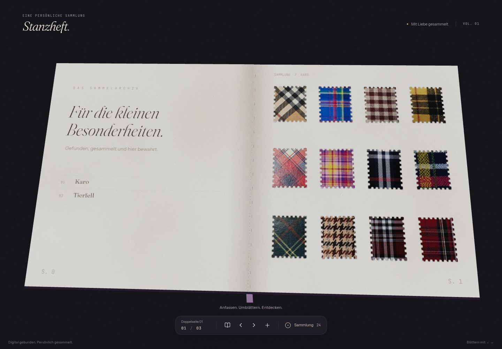

# Stanzheft 3D

Ein persönliches Sammelheft für Ausstanz-Marken. Das Buch steht im Mittelpunkt: groß, beim Start aufgeklappt und mit einer kleinen Steuerleiste am unteren Rand.



## Das neue Design

- Großes 3D-Buch mit gebogenen Seiten, sichtbaren Buchkanten und Lesebändchen.
- Dunkler Leineneinband mit dezenten goldenen Details; innen feine Papierstruktur und eine gestaltete Inhaltsseite.
- Kleines HUD für Auf- und Zuklappen, Blättern und das Einkleben eigener Seiten.
- Sammlungsübersicht direkt im HUD: „Sammlung“ öffnet die Ringdiagramme und die Seitenliste. Eine separate Statistikfläche unter dem Buch entfällt.
- Ruhiger Silk-Hintergrund, zurückhaltende Bewegung und eine an Mobilgeräte angepasste Oberfläche.

## Im Browser ansehen

**Website:** https://stanzheft.vercel.app

Der neue Designstand liegt auf dem Branch [`claude/nice-lamport-t8ab40`](https://github.com/NoFufu/3D-Stampbook-/tree/claude/nice-lamport-t8ab40). Ein Git-Push und eine Veröffentlichung bei Vercel sind getrennte Schritte; ob die Website bereits diesen Stand zeigt, ist derzeit nicht bestätigt.

Für eine interaktive Vorschau im [Vercel-Dashboard](https://vercel.com/dashboard) das Projekt „stanzheft“ öffnen und unter „Deployments“ nach dem Branch suchen. Falls noch kein Deployment existiert, über „Create Deployment“ diesen Branch auswählen. Der dort angezeigte Vorschaulink gehört zum jeweiligen Deployment.

Das Bild oben zeigt die getestete Anwendung. Die Dateien in `preview/` sind eine frühere HTML-Skizze und zeigen nicht das aktuelle Design.

## Starten

```bash
npm ci
npm run dev      # http://localhost:3000
npm run build    # Produktions-Build
npm run start    # Produktions-Build lokal starten
npm run lint
npx tsc --noEmit # TypeScript prüfen
```

Node.js 24 und npm 11 wurden für die Entwicklung verwendet. Der Build lädt die Schriften von `fonts.googleapis.com` und `fonts.gstatic.com`; dafür ist Netzwerkzugriff erforderlich. Entwicklungsserver und Produktions-Build nacheinander ausführen, da beide `.next/` verwenden.

## Bedienung

- **Auf- und Zuklappen:** Buchsymbol im HUD. Das Heft startet aufgeklappt.
- **Umblättern:** freie Seitenfläche antippen (rechts = weiter, links = zurück), ein Blatt anfassen und ziehen, Pfeiltasten oder die Pfeile im HUD.
- **Sammlung ansehen:** „Sammlung“ im HUD öffnen; auf dem Handy das Ringsymbol mit der Markenanzahl. Mit `Esc`, dem Schließen-Symbol oder einem Klick außerhalb wieder schließen.
- **Marke ansehen:** auf eine Marke tippen
- **Seite einkleben:** `+` im HUD oder die Seite „Seite einkleben“ hinten im Heft. Fotos werden lokal im Browser (IndexedDB) gespeichert. Eigene Fotos erscheinen in der Sammlungsübersicht als Fotos und werden nicht als automatisch erkannte Marken gezählt.

## Aufbau

| Pfad | Inhalt |
|---|---|
| `src/components/book/Book3D.tsx` | 3D-Heft mit React Three Fiber, gebogenes Papier beim Umblättern, Ziehen zum Blättern |
| `src/components/book/page-texture.ts` | zeichnet jede Heftseite als Textur (Umschlag, 4 × 3 Marken, Fotos) |
| `src/lib/stamps.ts`, `public/stamps/` | die 24 Marken (Karo & Tierfell), ausgeschnitten aus Fotos der echten Heftseiten |
| `src/lib/pages.ts` | Seitenreihenfolge und lokale Ablage der eingeklebten Fotos |
| `src/components/StampbookApp.tsx` | Buchansicht, kompaktes HUD, aufklappbare Sammlung und Dialoge |
| `src/components/CollectionStats.tsx` | Ringdiagramme und Seitenliste innerhalb der Sammlungsübersicht |
| `src/components/Background.tsx`, `src/components/Silk.tsx` | ruhiger Silk-Hintergrund; animierte Hintergründe werden bei reduzierter Bewegung ausgeblendet |

Komponenten aus fremden Bibliotheken (per shadcn-Registry installiert, nicht von Hand geschrieben):

- **[React Bits](https://reactbits.dev/):** `Dock` im kompakten HUD und `Silk` als Hintergrund.
- **[Aceternity UI](https://ui.aceternity.com/components):** `FileUpload` zum Einkleben eigener Seiten.
- **[Bklit UI](https://bklit.com/docs/components):** `RingChart` in der aufklappbaren Sammlungsübersicht.

Produktions-Build, TypeScript und Browserprüfungen auf Desktop und Mobilgerät wurden erfolgreich ausgeführt. ESLint meldet eine bestehende Warnung in `src/components/ui/file-upload.tsx`.

Der frühere Entwurfsplan liegt in [`docs/PLAN.md`](docs/PLAN.md); er enthält auch noch nicht umgesetzte Ideen wie ein Backend und automatische Markenerkennung.
